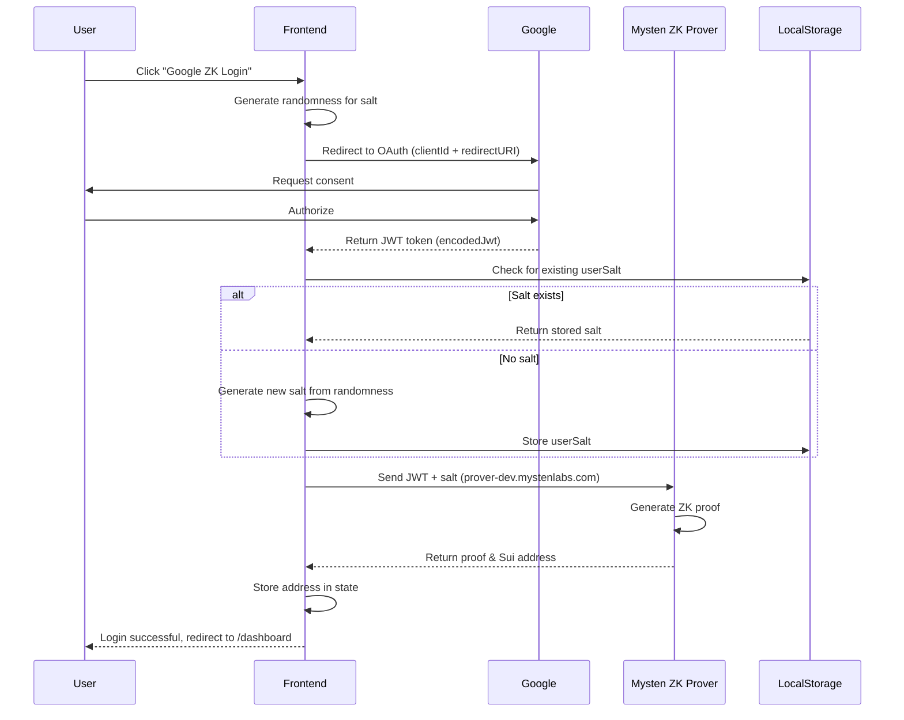
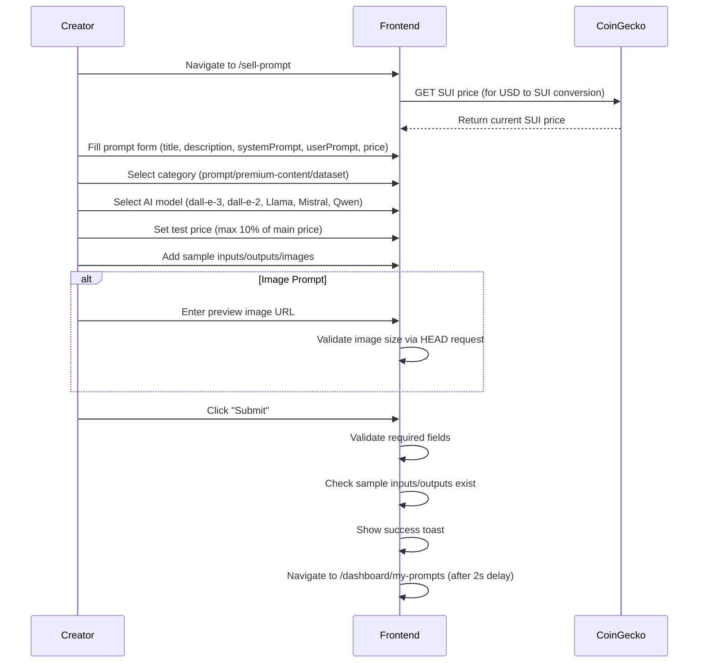
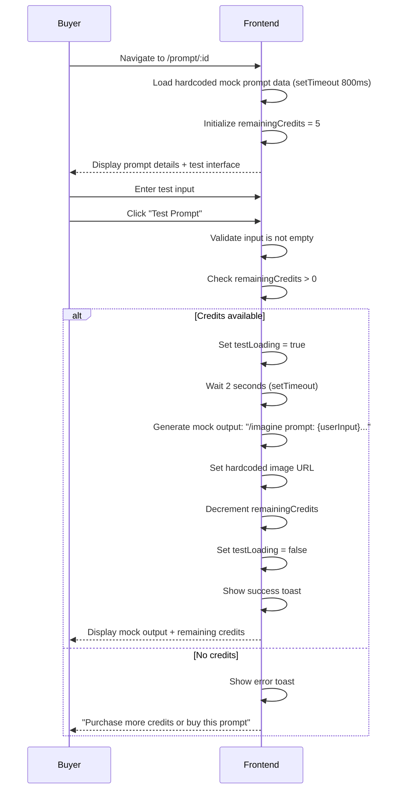
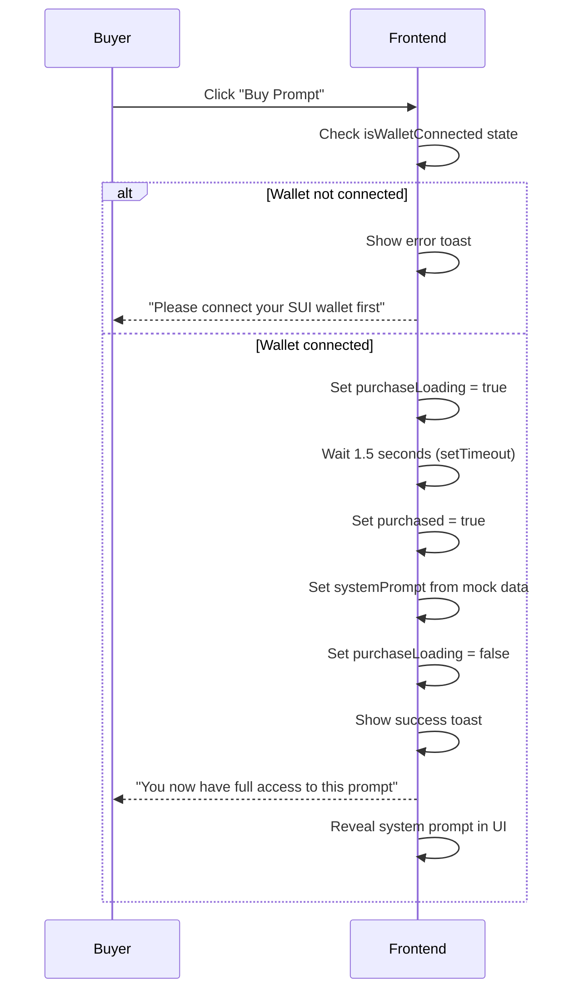
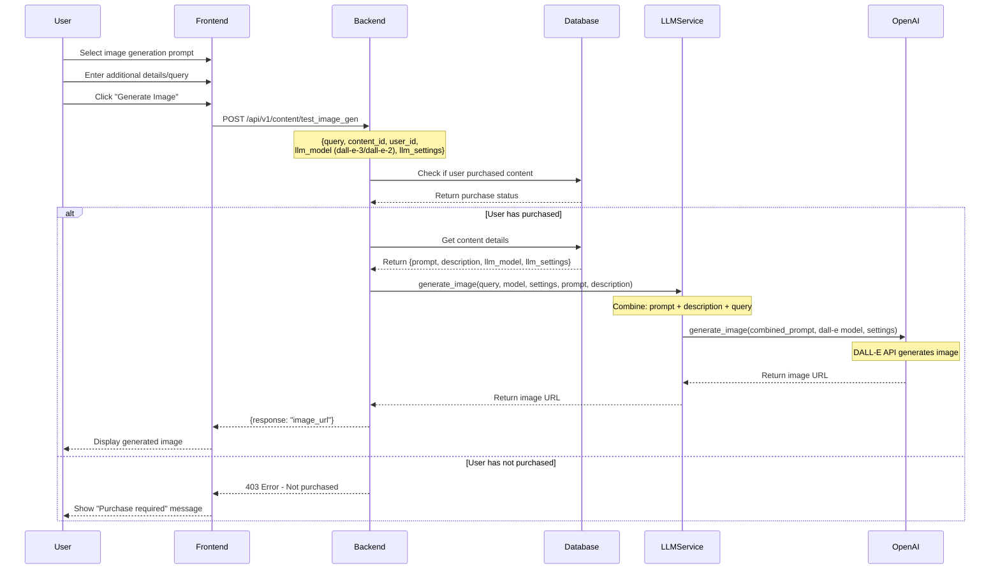
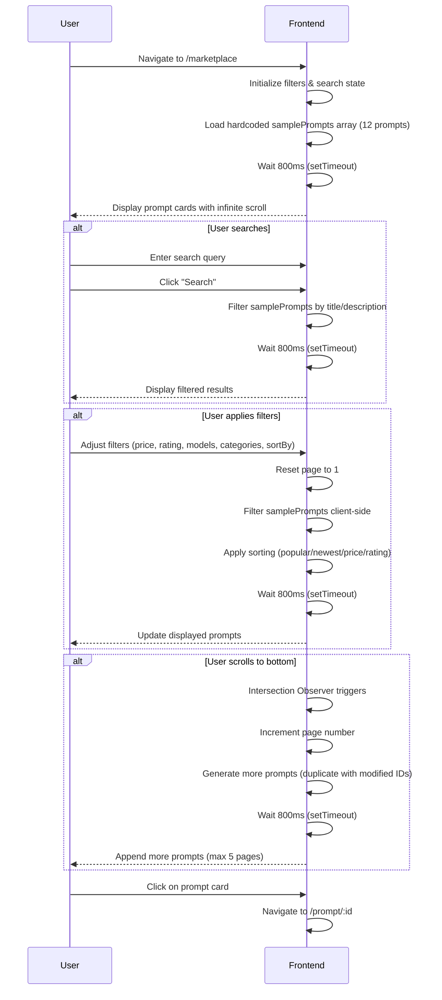
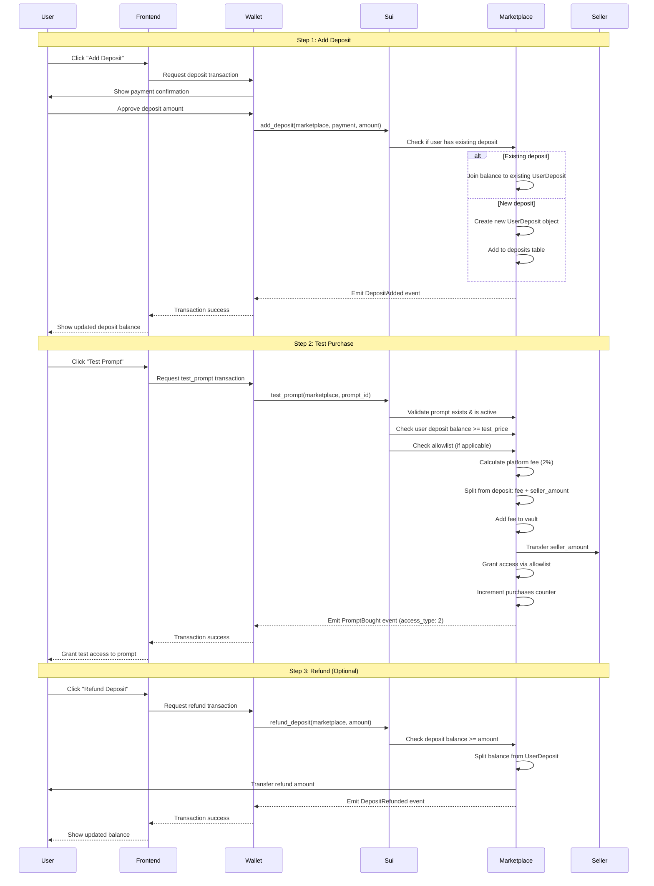

# **Prompt Sui - Product Overview Document**

## **1. Product Overview**

**Prompt Sui** is a decentralized marketplace built on the Sui blockchain that enables prompt engineers to monetize their AI prompts while providing buyers with verification tools to test prompts before purchase. The platform supports both text and image prompts with cryptographic security and decentralized storage.

---

## **2. Core Features**

### **Feature Matrix**

| Feature | Description | Technical Implementation |
|---------|-------------|-------------------------|
| **Prompt Listing & Selling** | Create and list text/image prompts for sale with custom pricing | Sui smart contracts + Walrus storage |
| **Test Before Buying** | Execute prompts with custom inputs (rate-limited) | LLM Inference with custom user query|
| **ZK Login Integration** | Google login via zero-knowledge proofs | Mysten Labs ZK Login |
| **Decentralized Storage** | Store large prompts and images on Walrus | Walrus Protocol (blob storage) |
| **Secure Transactions** | Purchase prompts with automatic royalty distribution | Sui Pay + Escrow smart contracts |
| **Prompt Encryption** | Protect prompt content until purchase | SEAL Protocol encryption |
| **Global Marketplace** | Browse and filter prompts by category, AI model, rating | Indexer + Search API |

---

## **3. Technology Stack**

### **Blockchain & Protocol Layer**
- **Sui Blockchain**: High-performance Move-based chain for transactions and ownership
- **Walrus Protocol**: Decentralized blob storage for image prompts and large text prompts
- **Seal Protocol**: Cryptographic sealing/unsealing of prompt content
- **Atoma Network**: Decentralized AI inference for prompt testing and verification

### **Authentication & Identity**
- **Sui ZK Login**: Zero-knowledge proof authentication (Google OAuth)
- **Mysten Labs Wallet Kit**: Wallet connection and transaction signing

### **Frontend**
- **Next.js 14+**: React framework with App Router
- **TypeScript**: Type-safe development
- **Tailwind CSS**: Responsive UI styling
- **Vercel**: Deployment and edge functions

### **Storage & Indexing**
- **Walrus Aggregators**: Primary storage for prompt data
- **PostgreSQL**: Off-chain metadata indexing for search/discovery
- **Redis**: Rate limiting for prompt testing

---

## **4. Sequence Diagrams**

### **Diagram 1: User Registration with ZK Login**

### **Diagram 2: Prompt Creation & Listing**

### **Diagram 3: Prompt Testing Flow**

### **Diagram 4: Purchase & Instant Delivery**

### **Diagram 5: Image Generation Flow**

### **Diagram 6: Marketplace Browse & Search**

### **Diagram 7: Deposit-Based Test Purchase (Blockchain)**

---

## **6. API Endpoints**

### **Content Management**

| Method | Endpoint | Description |
|--------|----------|-------------|
| **POST** | `/api/v1/content/add_text_completion` | Add new text completion prompt |
| **POST** | `/api/v1/content/add_image_generation` | Add new image generation prompt |
| **POST** | `/api/v1/content/search` | Search prompts with filters |
| **GET** | `/api/v1/content/get_content/{content_id}` | Get single prompt details |
| **GET** | `/api/v1/content/get_content_by_owner/{owner_id}` | Get all prompts by creator |
| **POST** | `/api/v1/content/purchase` | Purchase a prompt |
| **GET** | `/api/v1/content/list_model_names` | List available AI models |
| **POST** | `/api/v1/content/test_chat_completion` | Test text prompt (rate-limited) |
| **POST** | `/api/v1/content/test_image_gen` | Test image prompt (rate-limited) |
| **GET** | `/api/v1/content/total_sold/{content_id}` | Get total sales for a prompt |
| **GET** | `/api/v1/content/total_purchased/{user_id}` | Get user's total purchases |
| **GET** | `/api/v1/content/total_sold_by_user/{user_id}` | Get creator's total sales |
| **GET** | `/api/v1/content/n_items/{n}` | Get N recent items |

### **User Management**

| Method | Endpoint | Description |
|--------|----------|-------------|
| **POST** | `/api/v1/users/` | Create new user profile |
| **GET** | `/api/v1/users/{user_id}` | Get user profile details |
| **GET** | `/api/v1/users/{user_id}/purchases` | Get user's purchase history |

---

---

## **10. Contact & Resources**

- **Demo**: https://promptsui.vercel.app/
- **GitHub**: https://github.com/Abishkardhenga/p2p